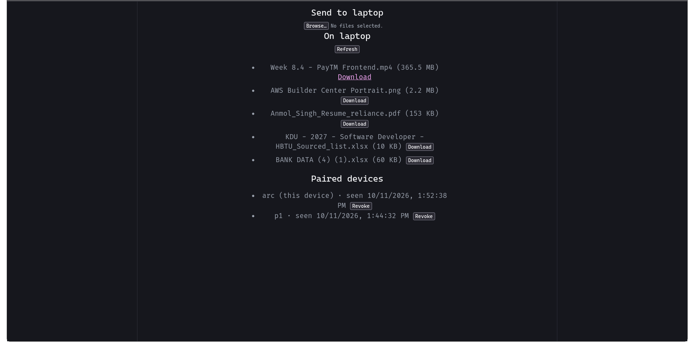
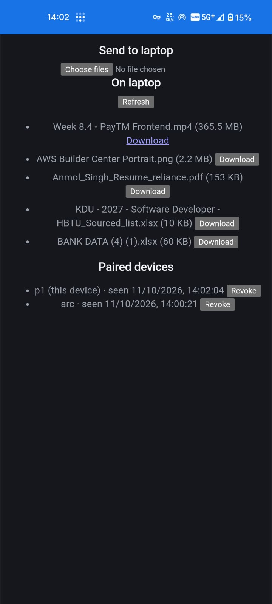

# airdrop-arch

#Why useful for me ? --> it replaces loading whatsapp web app everytime I want to share something to my self and reduces RAM usage. 

**Wireless file transfer between Arch Linux and Android.** No cloud, no account, no cable.





A small server runs on your laptop. Your phone opens it in the browser (or as an installed app) to upload files to the laptop and download files from it. Large transfers survive Wi-Fi drops, and every file is checksum-verified.

## Features

- **Resumable uploads:** 8 MB chunks that continue after a dropped connection, a page reload, or a server restart
- **Verified:** SHA-256 is checked before a file appears; corrupt uploads are rejected
- **Secure by default:** HTTPS, plus one-time QR pairing with revocable devices
- **Laptop to phone push:** `python send.py file.pdf` and the phone shows a banner within a second
- **Installable PWA** on phone and laptop, running as a systemd user service

## Architecture

```
   Phone (browser or installed PWA)               Laptop (Arch Linux)
  +-----------------------------+  HTTPS / WSS  +--------------------------------+
  |  React web app              | <-----------> |  FastAPI agent (uvicorn)       |
  |   upload queue, file list,  |               |   REST API, WebSocket,         |
  |   paired devices            |               |   pairing and sessions         |
  +-----------------------------+               +----------+---------------+-----+
                                                           |               |
                                                   ~/Share folder     SQLite database
                                                   (the files)        (devices, events)
```

Three parts, nothing else to deploy: the **web app** (`web/`, served by the agent itself), the **agent** (`agent/`, FastAPI), and the **shared folder** (`~/Share`). Whatever is in the folder shows up on the phone, and whatever the phone uploads lands there.

**Upload.** The server is the source of truth for progress, which is what makes resuming safe:

```
Phone                                       Laptop
  | POST /api/uploads {name, size}  ----->  create session + .part file
  | PUT  /api/uploads/ID?offset=0   ----->  write an 8 MB chunk
  | ... Wi-Fi drops ...
  | GET  /api/uploads/ID            ----->  {"offset": 13 MB}
  | PUT  next chunk at that offset  ----->  continue
  | POST /api/uploads/ID/complete   ----->  verify SHA-256, move into ~/Share
```

**Pairing.** `python pair.py` shows a QR code with a one-time token (`https://HOST:8000/#pair=...`). The phone sends it to `/api/pair` and gets a session cookie. Every other endpoint answers `401` without that cookie.

**Laptop to phone.** `send.py` copies the file into `~/Share` and records an event. The server pushes it over a WebSocket, and the phone shows a banner. Files up to 200 MB download in-app with a checksum check; larger ones use the browser's native download manager.

## Quick start

Requires Python 3.11+, Node.js 18+, and a phone on the same network.

```bash
git clone https://github.com/ianmol94/airdrop-arch.git && cd airdrop-arch

cd agent && python -m venv .venv && source .venv/bin/activate
pip install -r requirements.txt

cd ../web && npm install && npm run build

cd ../agent && python run.py
```

Scan the QR code with your phone camera. The first time, the browser warns that the certificate is self-signed: tap **Advanced**, then **Proceed**, and name the device. To remove the warning, see [Trusted HTTPS](#trusted-https-optional).

| Command (from `agent/`) | Purpose |
|---|---|
| `python pair.py` | Pairing QR code (uses the Tailscale name if configured) |
| `python pair.py lan` | Pairing QR code that uses the laptop's LAN IP |
| `python pair.py list` / `revoke <id>` | List or revoke paired devices |
| `python send.py <file>` | Push a file to the phone |

Settings: `AIRDROP_DIR` (shared folder, default `~/Share`) and `AIRDROP_PORT` (default `8000`).

### Pair a new device

Every device pairs once. A pairing code works one time and expires after 5 minutes.

| Situation | Command | Tailscale on the device? |
|---|---|---|
| Your own device, on any network | `python pair.py` | Yes, signed in to the same Tailscale account |
| Another device on the same Wi-Fi | `python pair.py lan` | No |

1. On the laptop, run the command from the table (from `agent/`, with the virtualenv active).
2. On the new device, scan the QR code or type the printed URL.
3. Name the device when asked. It stays paired from then on.
4. For a one-off transfer, revoke the device afterwards: `python pair.py list`, then `python pair.py revoke <id>`.

Notes for the LAN route:

- Both devices must be on the same Wi-Fi, and the router must not isolate clients (some guest and campus networks do).
- The browser shows a certificate warning, because the certificate matches the Tailscale name rather than the IP. Tap **Advanced**, then **Proceed**.
- Browsers don't offer to install the PWA from an IP address, so use a bookmark instead.
- The laptop's IP can change. Reserve it in your router, or check it with `ip route get 1.1.1.1`.

Without Tailscale set up, plain `python pair.py` already prints the LAN address.

### Run as a service

```ini
# ~/.config/systemd/user/airdrop-arch.service
[Unit]
Description=airdrop-arch file transfer agent

[Service]
WorkingDirectory=%h/path/to/airdrop-arch/agent
ExecStart=%h/path/to/airdrop-arch/agent/.venv/bin/python run.py
Restart=on-failure
RestartSec=3

[Install]
WantedBy=default.target
```

```bash
systemctl --user daemon-reload && systemctl --user enable --now airdrop-arch
```

## Trusted HTTPS (optional)

A self-signed certificate works, but browsers warn about it and Chrome won't install the PWA. With [Tailscale](https://tailscale.com) you get a real certificate and a stable name that also works away from home.

1. Install Tailscale on both devices, sign in, and enable **MagicDNS** and **HTTPS Certificates** in the admin console.
2. Issue a certificate:
   ```bash
   mkdir -p ~/.config/airdrop-arch/ts
   tailscale cert --cert-file ~/.config/airdrop-arch/ts/host.crt \
                  --key-file ~/.config/airdrop-arch/ts/host.key \
                  <machine>.<tailnet>.ts.net
   ```
3. Create `~/.config/airdrop-arch/config.json`:
   ```json
   { "host": "<machine>.<tailnet>.ts.net",
     "cert": "~/.config/airdrop-arch/ts/host.crt",
     "key": "~/.config/airdrop-arch/ts/host.key" }
   ```
4. Restart the service and run `python pair.py`. The QR code now uses the trusted name.

Certificates last about 90 days; restarting the service renews them. At home, the LAN address is the fast path. If `tailscale ping <phone>` reports `via DERP`, traffic is relayed and will be slow, and turning off mobile data on the phone usually restores a direct connection.

## Security

| Risk | Protection |
|---|---|
| Strangers on the Wi-Fi | Every data endpoint needs a paired session; all traffic is TLS |
| Guessing a pairing code | 128-bit token, single use, expires in 5 minutes |
| Leaked database or logs | Only token hashes are stored; the token travels in the URL fragment, which browsers never send |
| Session theft, CSRF | `HttpOnly`, `Secure`, `SameSite=Strict` cookie |
| Path traversal | Only the bare file name is ever used |
| Corrupt files | Uploads go to a `.part` file and appear only after the checksum matches |

Known limits: with the self-signed certificate, click-through is only safe on networks you trust; any paired device can revoke another; the static UI shell is public (all data is not); with Tailscale your machine name appears in public certificate-transparency logs (file contents do not); in-app downloads are capped at 200 MB because browsers hold the whole file in memory to save it.

<details>
<summary>API reference</summary>

| Method | Path | Purpose |
|---|---|---|
| POST | `/api/pair` | Exchange a pairing token for a session (only open endpoint) |
| GET | `/api/me` | Current device |
| POST | `/api/uploads` | Start an upload |
| GET / PUT | `/api/uploads/{id}` | Server offset / send a chunk (`?offset=N`) |
| POST / DELETE | `/api/uploads/{id}/complete`, `/api/uploads/{id}` | Verify and publish / cancel |
| GET | `/api/files`, `/api/files/{name}`, `/api/files/{name}/sha256` | List, download (HTTP Range), checksum |
| GET / DELETE | `/api/devices`, `/api/devices/{id}` | List / revoke devices |
| WebSocket | `/api/ws` | Live events |

</details>

<details>
<summary>Project layout</summary>

```
agent/   app/main.py (routes, auth, WebSocket), app/security.py (pairing, TLS, SQLite),
         run.py, pair.py, send.py
web/     src/ (App.jsx, uploader.js, downloader.js, pairing.js, live.js),
         public/ (PWA manifest, service worker, icons)
packaging/   systemd unit, PKGBUILD
docs/        screenshot and notes
```

</details>

## Benchmarks

Measured on my own network (replace the blanks with your numbers).

| Test (2 GB file) | Speed |
|---|---|
| Phone to laptop, LAN | 80 MB/s |
| Laptop to phone, LAN | 100 MB/s |


## Roadmap

Semantic search over the shared folder, a fallback for networks that block device-to-device traffic, a native Android app, and an AUR package.

## License

MIT. See [LICENSE](LICENSE).
